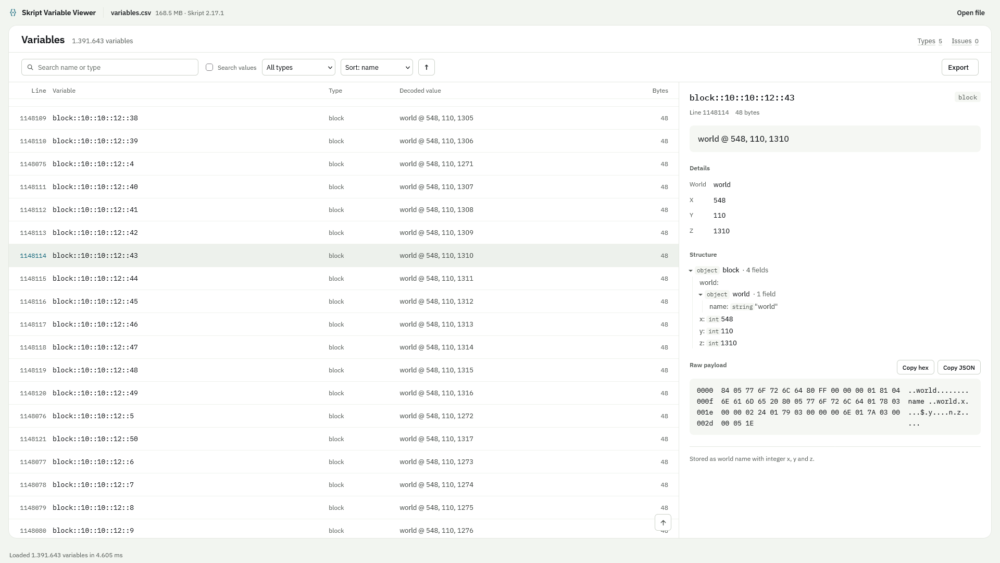

# Skript Variable Viewer

A viewer for Skript's `variables.csv` file. It parses the file locally in the browser.\
Available on: [https://karak.al/skript-variable-viewer](https://karak.al/skript-variable-viewer)

